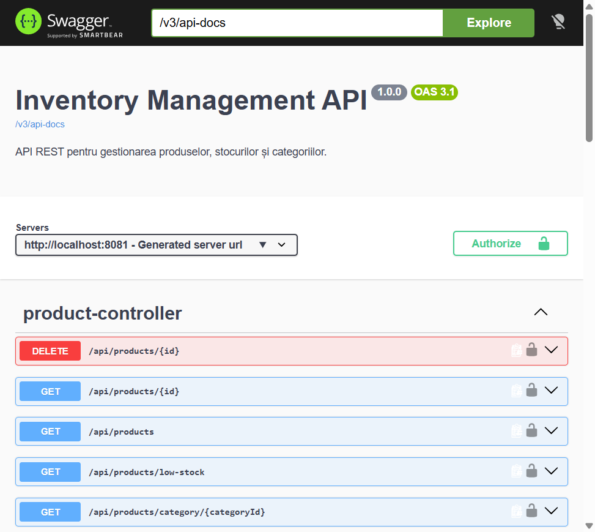

# 📦 Inventory Manager REST API


[](https://github.com/RazvanAndrei2005/inventory-manager/actions/workflows/ci.yml)


A RESTful backend API built with **Spring Boot 4** and **Java 25** for managing products, product categories, and users in an inventory system. It features stateless **JWT authentication**, **role-based authorization**, dynamic product filtering, pagination, optimistic locking, **PostgreSQL with Flyway migrations**, **Testcontainers** integration tests, **GitHub Actions CI**, and OpenAPI/Swagger documentation.

---

## 🛠️ Tech Stack

* **Java**: 25
* **Framework**: Spring Boot 4.1.1
* **Security**: Spring Security + JWT (JJWT 0.12.6)
* **Database**: PostgreSQL 16 (via Docker Compose)
* **Migrations**: Flyway (`V1__init_schema.sql`), Hibernate set to `ddl-auto=validate`
* **ORM & Persistence**: Spring Data JPA / Hibernate
* **Validation**: Spring Validation (Jakarta Bean Validation)
* **Documentation**: SpringDoc OpenAPI 3 (Swagger UI)
* **Testing**: JUnit 5, Mockito, AssertJ, MockMvc, Testcontainers (PostgreSQL)
* **CI/CD**: GitHub Actions (Java 25)
* **Boilerplate reduction**: Lombok
* **Build Tool**: Maven (`./mvnw` wrapper included)
* **Containers**: Docker & Docker Compose

---

## ✨ Key Features

* **Authentication & Authorization**: Register and log in to receive a JWT; access is controlled by roles (`ROLE_ADMIN`, `ROLE_MANAGER`, `ROLE_USER`) using `@PreAuthorize`.
* **User Profile & Administration**: Authenticated users can inspect their profile (`GET /api/users/me`); admins can list, view, change roles, and enable/disable user accounts (with self-modification guards).
* **Category Management**: Full CRUD with a guard that blocks deleting a category that still has products assigned (`409 CONFLICT`).
* **Product Management**: Full CRUD, restocking endpoint (rejects quantities `<= 0`), and low-stock queries.
* **Dynamic Filtering**: Filter products by name, SKU, price range, category, and stock range using JPA Specifications.
* **Pagination & Sorting**: Paginated responses via `Pageable`, integrated with Swagger through `@ParameterObject`.
* **N+1 Prevention**: `@EntityGraph` on product queries.
* **Optimistic Locking**: `@Version` field on `Product` prevents concurrent stock overwrites.
* **Transactional Correctness**: Mutating service methods are `@Transactional`; reads use `@Transactional(readOnly = true)`.
* **Database Versioning**: Schema is managed by Flyway migrations instead of Hibernate auto-DDL.
* **Config & Secrets Hygiene**: All secrets come from environment variables with no secret defaults; separate `dev` / `prod` / `test` profiles; `.env` is gitignored.
* **Global Exception Handling**: Unified `ErrorResponseDto` covering validation errors, missing resources, duplicates, access denied, bad credentials, disabled accounts, optimistic locking conflicts, data integrity violations, and generic errors.
* **Data Seeding**: An admin and a manager account are created on startup from environment variables.

---

## 🏗️ Project Structure

Layered architecture under `com.inventory.manager`:

| Package | Contents |
| --- | --- |
| `entity` | `User`, `Product`, `Category`, `Role` |
| `repository` | `UserRepository`, `ProductRepository`, `CategoryRepository` |
| `dto` | Request/response DTOs for all resources |
| `service` | `AuthService`, `UserService`, `AdminService`, `ProductService`, `CategoryService` |
| `controller` | `AuthController`, `UserController`, `AdminController`, `ProductController`, `CategoryController` |
| `security` | `SecurityConfig`, `JwtTokenProvider`, `JwtAuthenticationFilter`, `CustomUserDetails`, entry point & access denied handlers |
| `specification` | `ProductSpecification` (dynamic filtering) |
| `exception` | `GlobalExceptionHandler`, custom exceptions, `ErrorResponseDto` |
| `config` | `DataSeeder`, `OpenApiConfig`, `CorsConfig` |

Database migrations live in `src/main/resources/db/migration`.

---

## 🚀 Getting Started

### Prerequisites

* **JDK 25**
* **Maven 3.8+** (or use the included `./mvnw` / `mvnw.cmd` wrapper)
* **Docker & Docker Compose** (for PostgreSQL and Testcontainers tests)

### Environment Variables

The application reads its secrets and database settings from environment variables (locally you can copy `.env.example` to `.env`, which is gitignored). Required variables have no defaults so the app fails fast if any are missing:

| Variable | Description | Example / Default |
| --- | --- | --- |
| `DB_URL` | PostgreSQL JDBC connection URL | `jdbc:postgresql://localhost:5432/inventory_db` |
| `DB_USERNAME` | PostgreSQL username | `inventory_user` |
| `DB_PASSWORD` | PostgreSQL password | `change-me` |
| `JWT_SECRET` | Base64-encoded secret key (>= 32 bytes) used to sign JWTs | *(required, no default)* |
| `ADMIN_USERNAME` | Seeded admin username | `admin` |
| `ADMIN_EMAIL` | Seeded admin email | `admin@example.com` |
| `ADMIN_PASSWORD` | Seeded admin password | `change-me` |
| `MANAGER_USERNAME` | Seeded manager username | `manager` |
| `MANAGER_EMAIL` | Seeded manager email | `manager@example.com` |
| `MANAGER_PASSWORD` | Seeded manager password | `change-me` |
| `CORS_ALLOWED_ORIGINS` | Comma-separated allowed CORS origins | `http://localhost:3000` |
| `JWT_EXPIRATION_MS` | *(Optional)* Access token lifetime in milliseconds | `3600000` (1 hour) |
| `SPRING_PROFILES_ACTIVE` | *(Optional)* Active Spring profile (`dev`, `prod`, `test`) | `dev` |

### Installation & Execution

1. **Clone the repository:**
   ```bash
   git clone https://github.com/RazvanAndrei2005/inventory-manager.git
   cd inventory-manager
   ```

2. **Create your `.env` file from the template and fill in your secrets:**
   ```bash
   cp .env.example .env
   ```

3. **Start PostgreSQL:**
   ```bash
   docker compose up -d
   ```

4. **Run the test suite & build the application** (uses Testcontainers Postgres, no `.env` required):
   ```bash
   ./mvnw verify
   ```

5. **Run the application** (Flyway applies migrations automatically on startup):
   ```bash
   ./mvnw spring-boot:run
   ```

The API runs on port **8081**.

6. **Useful URLs:**

| Tool | URL |
| --- | --- |
| Swagger UI | `http://localhost:8081/swagger-ui.html` |
| OpenAPI JSON | `http://localhost:8081/v3/api-docs` |

---

## 📖 Swagger UI



---

## 🔐 Authentication

All routes require a valid JWT except `/api/auth/**` and Swagger UI (`/v3/api-docs/**`, `/swagger-ui/**`, `/swagger-ui.html`).

1. Register via `POST /api/auth/register` (new users receive `ROLE_USER`), or log in with a seeded account.
2. Call `POST /api/auth/login` to receive a token (response contains `accessToken`, `tokenType`, `username`, `role`).
3. Send it with each request:
   ```
   Authorization: Bearer <token>
   ```

> Access tokens are valid for **1 hour** by default (`JWT_EXPIRATION_MS=3600000`). Refresh tokens are planned (see Roadmap).

---

## 📑 API Endpoints Reference

### Auth (`/api/auth`)

| Method | Endpoint | Description |
| --- | --- | --- |
| `POST` | `/api/auth/register` | Register a new user (unique username/email required) |
| `POST` | `/api/auth/login` | Log in and receive a JWT, token type, username, and role |

### Users (`/api/users`) — Authenticated

| Method | Endpoint | Description |
| --- | --- | --- |
| `GET` | `/api/users/me` | Get the currently authenticated user's profile |

### Admin (`/api/admin/users`) — ADMIN only

| Method | Endpoint | Description |
| --- | --- | --- |
| `GET` | `/api/admin/users` | List all users (paginated) |
| `GET` | `/api/admin/users/{id}` | Get user by ID |
| `PATCH` | `/api/admin/users/{id}/role` | Update a user's role (`409` if targeting self) |
| `PATCH` | `/api/admin/users/{id}/status` | Enable or disable a user account (`409` if targeting self) |

### Categories (`/api/categories`)

| Method | Endpoint | Description |
| --- | --- | --- |
| `POST` | `/api/categories` | Create a category (`ADMIN` / `MANAGER`) |
| `GET` | `/api/categories` | Retrieve all categories (paginated) |
| `GET` | `/api/categories/{id}` | Get category by ID |
| `PUT` | `/api/categories/{id}` | Update a category (`ADMIN` / `MANAGER`) |
| `DELETE` | `/api/categories/{id}` | Delete a category (`ADMIN` only; `409` if products are still assigned) |

### Products (`/api/products`)

| Method | Endpoint | Description |
| --- | --- | --- |
| `POST` | `/api/products` | Create a product with an associated category (`ADMIN` / `MANAGER`) |
| `GET` | `/api/products` | Get all products (paginated, sorted, and filterable) |
| `GET` | `/api/products/{id}` | Get product by ID |
| `GET` | `/api/products/category/{categoryId}` | Get products by category (paginated) |
| `GET` | `/api/products/low-stock` | Retrieve products at or below a stock threshold (`threshold`, default `5`) |
| `PUT` | `/api/products/{id}` | Full update of a product (`ADMIN` / `MANAGER`) |
| `PATCH` | `/api/products/{id}/restock` | Add stock quantity (`quantity` request param, must be `> 0`; `ADMIN` / `MANAGER`) |
| `DELETE` | `/api/products/{id}` | Delete a product (`ADMIN` only) |

**Query parameters for `GET /api/products`:** `name`, `sku`, `minPrice`, `maxPrice`, `categoryId`, `minStock`, `maxStock`, plus standard `page`, `size`, and `sort`.

---

## ⚠️ Error Format

All errors return a consistent `ErrorResponseDto` structure:

```json
{
  "timestamp": "2026-11-21T12:00:00",
  "status": 404,
  "error": "Not Found",
  "message": "Product not found with id: 42",
  "path": "/api/products/42"
}
```

---

## 📊 Current Status

| Area | State |
| --- | --- |
| Core CRUD (products, categories, users) | ✅ Done |
| JWT auth & role-based access | ✅ Done |
| PostgreSQL + Flyway migration | ✅ Done |
| Config & secrets hardening, dev/prod/test profiles | ✅ Done |
| Unit & integration tests (JUnit 5, Mockito, MockMvc, Testcontainers) | ✅ Done |
| GitHub Actions CI (Java 25) | ✅ Done |
| Stock movements | 🔜 Planned |
| Orders | 🔜 Planned |
| Refresh tokens | 🔜 Planned |

---

## 🗺️ Roadmap

In order of priority:

1. **Stock movements** – track every stock change (restock, sale, adjustment)
2. **Orders** – order creation and stock deduction
3. **Refresh tokens** – shorter-lived access tokens with refresh flow
4. **Extras** – Redis caching, mail alerts, CSV/PDF export, image upload
5. **Frontend** – Next.js client
6. **Deployment** – containerized app and cloud deployment

---

## 📄 License

This project is licensed under the [MIT License](LICENSE).
